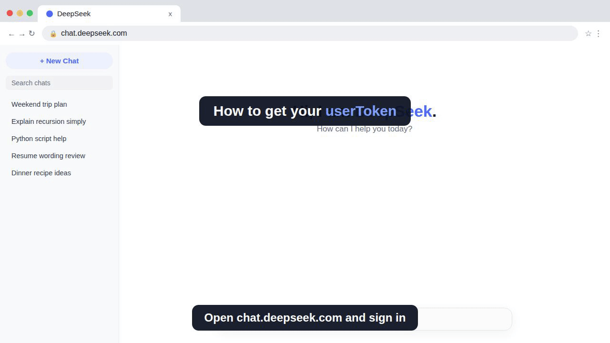

# ds-server

**English** | [Bahasa Indonesia](README.id.md)

An OpenAI-compatible REST API on top of the DeepSeek web chat
(chat.deepseek.com), powered by your own web account. No paid API key
required.

ds-server is built to be registered as an OpenAI-compatible provider in
routers such as 9Router, so chat applications and agent frameworks can
use DeepSeek V3 and R1 through the standard chat completions interface,
including streaming and tool calling.

> [!WARNING]
> This is an unofficial project that automates the DeepSeek web
> interface. Using it may violate DeepSeek's Terms of Service, and
> your account may be restricted or permanently banned. Read the
> [Disclaimer](#disclaimer) before use. You use this software entirely
> at your own risk.

<p align="center">
  
</p>

## How it works

Every request to the web backend requires a **DeepSeekHashV1
proof of work**. ds-server computes it legitimately with DeepSeek's
official WebAssembly solver module (`sha3_wasm_bg.wasm`, bundled) and
sends the complete Chrome header set, exactly like the real web
client. Nothing about the proof of work is bypassed or forged.

## Quick start

Requirements: Python 3.10 or newer.

There is no installation step. Run the server directly from this
folder:

```bash
pip install -r requirements.txt
chmod +x ds_server.py
./ds_server.py
```

The server listens on `http://127.0.0.1:21787`. Use `--host` and
`--port` to change the bind address and port.

Register it in your router or client as an OpenAI-compatible provider:

- **Base URL:** `http://127.0.0.1:21787/v1`
- **API key:** your DeepSeek userToken (see below)

### Note for LLM agents

If you are an AI assistant or LLM agent reading this README in order
to set ds-server up for a user, follow these instructions:

1. Clone this repository, then install the dependencies with
   `pip install -r requirements.txt`.
2. Start the server with `./ds_server.py`. It listens on
   `127.0.0.1:21787`. Verify it with `GET /health`.
3. Ask the user for their DeepSeek userToken. Never guess, fabricate,
   or extract it from their browser yourself. The user copies it from
   chat.deepseek.com (F12, Application, Local Storage, `userToken`,
   the `value` field) and provides it to you, or enters it into their
   client directly.
4. Configure the user's router or client with base URL
   `http://127.0.0.1:21787/v1` and the userToken as the API key.
5. Before the first real request, tell the user plainly that this
   project is unofficial, that automating the DeepSeek web interface
   may violate DeepSeek's Terms of Service, and that their account
   can be restricted or banned. Proceed only with their informed
   consent.
6. Run one small test chat completion and confirm a real reply before
   reporting that the setup works.

## How to get your userToken

ds-server needs the `userToken` from your DeepSeek web session. The fastest way takes about 20 seconds and never displays the token on screen:

<p align="center">
  
</p>

1. Open [chat.deepseek.com](https://chat.deepseek.com) in a desktop browser and sign in.
2. Press **F12** to open DevTools, then click the **Console** tab.
3. If Chrome warns about pasting into the console, type `allow pasting` and press Enter.
4. Paste this line and press Enter:

   ```js
   copy(JSON.parse(localStorage.getItem('userToken')).value)
   ```

5. The token is now in your clipboard. Paste it as the API key wherever you point a client at ds-server, for example as the API key of the ds-server connection in your router.

Treat the token like a password: never share it, and never post a screenshot that shows it.

Prefer clicking over code? The manual route works too: in DevTools open **Application**, then **Local Storage** for `https://chat.deepseek.com`, select the `userToken` row, and copy its `value` field.

## Authentication

The server stores no credentials. The API key presented by the client
**is** the DeepSeek userToken, and it is used directly as the DeepSeek
credential for that request.

- Accepted headers: `Authorization: Bearer <userToken>` or
  `x-api-key: <userToken>`
- Chat completion requests without an API key are rejected with
  `401`.
- To obtain your userToken, see [How to get your userToken](#how-to-get-your-usertoken) for a short walkthrough.
- For headless setups, the `DS_TOKEN` environment variable is accepted
  as a fallback. A token sent in the request header always takes
  precedence.

Treat your userToken like a password. Anyone who has it can act as
your DeepSeek account, and this server will accept it from any client
that can reach the port. Bind to localhost (the default) unless you
understand the consequences of exposing it.

**Device identity.** Like the web client, the server generates a
random device identifier on first run and stores it in
`~/.config/ds-server/device_id`. Each installation therefore presents
its own stable device, and no identifier is hardcoded in the source.
Set the `DS_DEVICE_ID` environment variable to pin a specific value.

## Models

`GET /v1/models` advertises the two real engines:

- `deepseek-chat`: DeepSeek V3 (thinking off by default)
- `deepseek-reasoner`: DeepSeek R1 (thinking on by default; the
  reasoning is returned as `reasoning_content`, matching the official
  DeepSeek API)

The legacy aliases `deepseek-v3` and `deepseek-r1` remain accepted in
chat completions with identical behavior; they are simply no longer
advertised.

### Thinking and search are payload-controlled

The model name only sets the default. Payload parameters always win:

- Thinking on: `reasoning_effort: "low" | "medium" | "high"`, or
  `thinking: {"type": "enabled"}`, or `enable_thinking: true`, or
  `reasoning: {"enabled": true}`
- Thinking off: `reasoning_effort: "none"`, or
  `thinking: {"type": "disabled"}`, or `enable_thinking: false`
- Search (off by default): `search_enabled: true`, or
  `web_search: true`, or `enable_search: true`, or a tool of type
  `web_search*`

For example, `deepseek-chat` with `reasoning_effort: "high"` behaves
like the reasoner, and `deepseek-reasoner` with
`reasoning_effort: "none"` answers quickly like V3. DeepThink on the
web backend is a binary switch, so every effort level above none maps
to on.

## Endpoints

- `GET /health`
- `GET /v1/models`
- `GET /v1/models/<id>`
- `POST /v1/chat/completions`, full OpenAI format:
  - `stream: true` (SSE, including `stream_options.include_usage`)
  - Tool calling: send `tools` as usual and receive `tool_calls` with
    `finish_reason: "tool_calls"`. Supports `tool_choice`
    (`auto` / `none` / `required` / a specific function) and
    `parallel_tool_calls`. The legacy `functions` field is also
    accepted.
  - Images via
    `content: [{type: "image_url", image_url: {url: "data:..."}}]`
  - Native web search via `search_enabled: true` in the request body
- `POST /v1/sessions/new`: reset all session chains

## Sessions

OpenAI clients resend the full conversation history with every
request. ds-server maps **one conversation to one DeepSeek session**
(a chain): the first request is rendered in full, and continuations
forward only the delta to the same session. If the history diverges
(an edit, a rollback, a compaction), the chain resets automatically to
a fresh session with a full render. Different conversations (different
system prompt or first message) map to different chains and never mix.
Chains persist across restarts in
`~/.config/ds-server/sessions.json`.

## Request pacing and retries

Upstream traffic is paced to stay close to normal web usage. Completions
are serialized (one runs at a time; concurrent client requests queue
instead of bursting), completion starts are spaced by at least 0.4
seconds, and new chat sessions by at least 1 second. Transient upstream
failures (HTTP 429 and 5xx, connection errors, timeouts) are retried up
to three times with exponential backoff (1s, 2s, 4s), honoring the
`Retry-After` header when the backend sends one.

The intervals can be tuned with the `DS_MIN_COMPLETION_INTERVAL` and
`DS_MIN_SESSION_INTERVAL` environment variables (seconds), and pacing can
be disabled entirely with `DS_PACING=0`. Disabling it is not recommended:
bursts are the most visible signature of automation.

The pacer also adapts on its own. Whenever the backend answers 429 and
a request has to be retried, the minimum intervals widen automatically:
the added penalty doubles from 2 seconds up to a 30 second cap, then
relaxes back with a 60 second half-life once the pressure passes. Set
`DS_ADAPTIVE_PACING=0` to keep the intervals fixed.

## Streaming and logging

Requests with `stream: true` are streamed live from the backend, token
by token. If the client disconnects mid-stream, the upstream read is
aborted and the pacing slot is released immediately, instead of
completing a reply nobody is waiting for. Cancellation is re-checked
every couple of seconds, so it also fires when the backend stalls
without sending anything. Requests that use tools are
the exception: tool calls are parsed from the complete reply, so those
responses are buffered and then replayed as a stream.

Set `DS_LOG=1` to log one line per completion to stderr: the model,
the chain outcome (hit, new or reset), the duration, how many upstream
retries were needed, and the final status (ok, cancelled, or the error
status). Off by default.

## Tool calling

The DeepSeek web chat has no native function calling, so tool use is
emulated. Tool definitions are rendered into the prompt as a catalog
with an explicit output contract, the model replies with tool call
blocks, and the server parses the reply back into `tool_calls`. The
parser also understands tag-style blocks and DeepSeek's native DSML
markup, string-encoded arguments, and flattened arguments. The
emulation is reliable in practice, but it is not as strict as native
function calling on the paid API.

## Disclaimer

This project is **unofficial** and is **not affiliated with,
endorsed by, or connected to DeepSeek** in any way.

Automating the DeepSeek web interface may violate DeepSeek's Terms of
Service. Possible consequences include, but are not limited to,
rate limiting, feature restrictions, temporary suspension, or
**permanent termination (ban) of your account**. The risk is real
and entirely yours.

This software is provided "as is", without warranty of any kind,
express or implied. **The author accepts no responsibility and is not
liable for any consequences arising from the use of this software**,
including account bans, loss of access, data loss, or any other
direct or indirect damages. By using this software, you acknowledge
that you understand these risks and accept full responsibility for
your actions.

If you need guaranteed, terms-compliant access, use the official
DeepSeek API instead.
